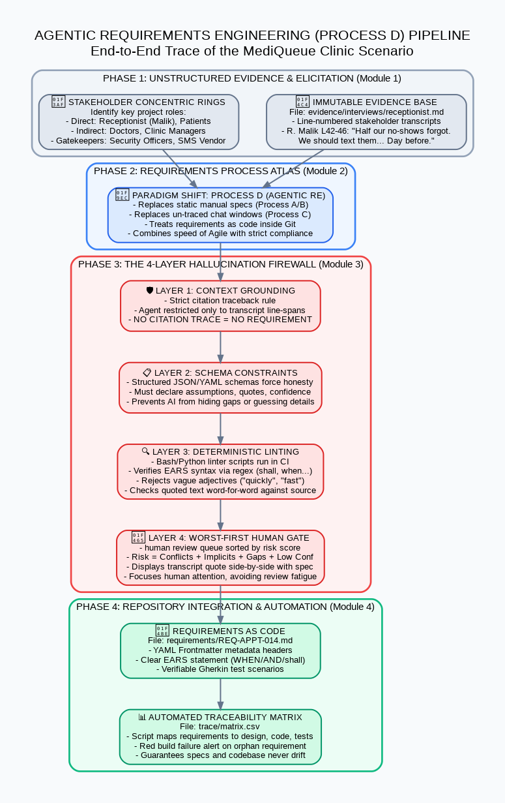
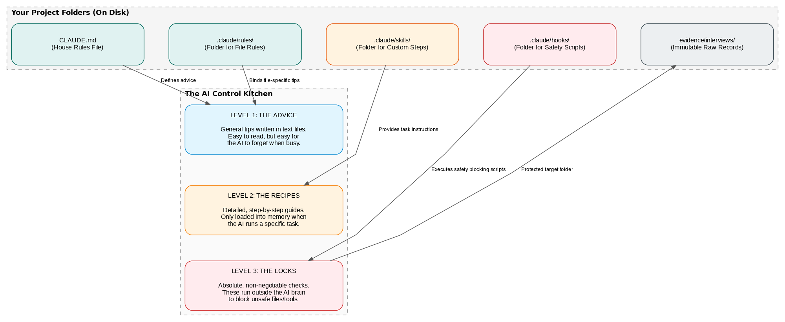

# Agentic Requirements Engineering: Automated Guardrails & Quality Gates

> **A Comparative Study & Defense-in-Depth System**: Transitioning from Ambiguous Generative AI (Process C) to Self-Defending, Linter-Validated Agentic Workspaces (Process D) for Safety-Critical Software Systems.

[](https://github.com/Zaryab111/agentic-requirements-engineering/actions/workflows/requirements-ci.yml)
[](LICENSE)
[](https://www.python.org/downloads/)
[](https://www.sciencedirect.com/science/article/pii/S1877050917300305)
[](https://www.iso.org/standard/45171.html)

---

## 📌 Executive Overview

Traditional Requirements Engineering (RE) is notoriously prone to human error, subjective ambiguity (*"fast"*, *"intuitive"*, *"sufficient"*), and lost stakeholder traceability. While modern engineering teams attempt to leverage Generative AI (LLMs) to draft specifications, **unguided LLMs introduce catastrophic risks**: hallucinated business logic, impossible calendar deadlines, atomicity violations, and severe security/HIPAA compliance vulnerabilities.

This repository demonstrates **Process D (The Guarded Agentic Repository)**: an automated, multi-agent RE system with deterministic repository guardrails, pre-write environment hooks, character-accurate transcript quote verifiers, and CI/CD quality firewalls.



---

## ⚖️ Empirical Comparison: Unguided LLM vs. Guarded Agentic RE

The case study evaluates raw stakeholder interviews from **MediQueue**, a high-volume outpatient clinical scheduling platform, focusing on frontline operational friction reported by Senior Receptionist R. Malik.

| Metric / Dimension | Unguided LLM (Process C) | Guarded Agentic Workspace (Process D) |
|---|---|---|
| **Elicitation Method** | Single-prompt raw text generation | Multi-agent protocol (Elicitor & Specifier roles via `AGENTS.md`) |
| **Traceability** | None (ungrounded hallucinated features) | **100% Verbatim Quotation** with transcript line citations (`L38–L48`) |
| **Ambiguity Prevention** | Fails (rampant use of *"immediately"*, *"real-time"*, *"intuitive"*) | **Automated Banned-Word AST / Regex Scanner** rejects all subjective terms |
| **Grammar Standard** | Inconsistent narrative natural language | **Strict EARS Syntax** (`WHEN`, `WHILE`, `WHERE`) with mandatory *"shall"* |
| **Quality Gate** | Manual human review (often skipped) | **Two-Layer Automated Gate**: Local Python AST Linter + GitHub Actions CI |
| **Tamper Resistance** | Raw stakeholder quotes can be modified | Pre-tool bash hooks (`protect-evidence.sh`) enforce file immutability |
| **Security & Privacy** | Introduces HIPAA leaks & terminal lockout risks | Privacy-by-design & defense-in-depth verified specifications |

---

## 🛡️ Multi-Layer Defense-in-Depth Architecture



The repository implements a **four-layer defense firewall** to guarantee that invalid requirements cannot enter production:

1. **Layer 1: Pre-Tool Environment Isolation (`.claude/hooks/protect-evidence.sh`)**
   - Intercepts file modification commands before execution.
   - Restricts write permissions on the `evidence/` directory to guarantee raw interview transcripts remain tamper-proof.
2. **Layer 2: Agent Skill & Schema Protocol (`.claude/skills/elicit/SKILL.md` & `requirements/_schema.json`)**
   - Directs the Elicitor Agent to extract candidates exclusively from verifiable transcript markers.
   - Enforces a JSON Schema Draft-07 validator across all frontmatter metadata.
3. **Layer 3: Dynamic Rule Enforcement (`.claude/rules/requirements.md`)**
   - Establishes zero-tolerance lexical filters for qualitative adjectives (*"fast"*, *"sufficient"*, *"laggy"*, *"evening"*, *"appropriate"*).
   - Dynamically consumed by test scripts without hardcoding.
4. **Layer 4: Automated CI/CD Quality Gate (`scripts/lint-requirements.py` & GitHub Actions)**
   - Character-by-character regex verification confirming cited text matches the immutable interview file.
   - Builds in GitHub Actions on every pull request, blocking merging on lint violations.

---

## 🔍 Critical Failure Post-Mortems: Unguided AI Bugs Caught

A direct audit comparing the baseline unguided LLM output ([`baseline-unguided-llm/`](baseline-unguided-llm/)) against the guarded specifications ([`requirements/`](requirements/)) revealed four critical failure modes caught by our pipeline:

### 1. REQ-SMS-001: Operational Deadline Paradox & Same-Day Scheduling Crash
* **Unguided AI Defect**: Dictated sending SMS reminders *"24 hours before scheduled appointment time"*.
  * *Operational Failure*: Stakeholder explicitly requested: *"If I know by the evening I can fill it"* (L46). For a 19:00 appointment, an SMS sent at 19:00 the day prior is received after clinic hours, leaving zero lead time for front-desk staff.
  * *System Crash*: For same-day bookings booked at 09:00 for 14:00, calculating `T - 24h` schedules a trigger in the past, causing cron schedulers and queues to crash.
* **Guarded Agentic Solution**: Qualified event-driven EARS trigger bounded by an objective calendar deadline:
  > *"WHEN a patient has a confirmed appointment scheduled for the following calendar day, the system shall send one SMS reminder... no later than 18:00 local time on the day before the appointment."*

### 2. REQ-SMS-002: Non-Verifiable Adjectives & Transactional Atomicity Violation
* **Unguided AI Defect**: Required the system to *"immediately release the time slot back and send a confirmation SMS"*.
  * *Untestable "Smell"*: In distributed databases, network and lock latency make "immediately" mathematically unverifiable.
  * *Atomicity Violation*: Coupled the database transaction to third-party SMS gateway response. If the SMS carrier drops, the freed slot rollback blocks re-booking.
* **Guarded Agentic Solution**: Isolated the transactional slot release from outbound messaging and set a testable boundary (`within 30 seconds`).

### 3. REQ-SMS-003: Catastrophic HIPAA / GDPR Privacy Exposure
* **Unguided AI Defect**: Mandated displaying an on-screen popup showing: *"freed slot date, time, practitioner name, and the name of the patient who cancelled"*.
  * *Privacy Violation*: Reception desks are public-facing counters where queued patients can view monitors. Exposing cancelling patients' names violates HIPAA and GDPR data minimization requirements.
* **Guarded Agentic Solution**: Restricts front-desk alerts to operational metadata only (*date, time, and slot duration*), preserving patient confidentiality.

### 4. REQ-AUTH-001: 30-Minute Idle Terminal Security Hazard
* **Unguided AI Defect**: Mandated maintaining an active session for 8 hours with an unauthenticated 30-minute idle tolerance and quick PIN entry.
  * *Security Hazard*: Leaving clinical workstations unlocked on a public counter for 30 minutes permits unauthorized electronic health record (EHR) access. On-screen PIN entry is also vulnerable to shoulder-surfing.
* **Guarded Agentic Solution**: Bounded continuous authenticated sessions to 60 minutes with a 15-minute idle timeout lock, formalizing hardware RFID card-tap authentication via Architecture Decision Record (ADR).

---

## 📂 Repository Layout

```
.
├── .claude/
│   ├── hooks/
│   │   └── protect-evidence.sh        # Deterministic bash hook blocking evidence tampering
│   ├── rules/
│   │   └── requirements.md            # Path-scoped rules enforcing EARS & dynamic banned words
│   ├── skills/
│   │   └── elicit/
│   │       └── SKILL.md               # 8-step extraction protocol for Elicitor Agent
│   └── settings.json                  # IDE hook bindings & environment configuration
├── .github/
│   └── workflows/
│       └── requirements-ci.yml        # GitHub Actions CI quality gate
├── assets/
│   ├── agentic-re-four-modules-v2.png # Four-module pipeline architecture diagram
│   └── claude-environment-control-v3.png # Defense-in-depth repository firewall diagram
├── baseline-unguided-llm/             # Baseline outputs from raw unguided Generative AI
│   ├── mediqueue_requirements.md      # Unguided draft showing hallucinated scope & bugs
│   └── mediqueue_detailed_reqs.md     # Detailed unguided requirements and user stories
├── docs/                              # Research papers, walkthroughs & presentations
│   ├── claude comapriosn walkthrough.docx # Comprehensive side-by-side engineering post-mortem
│   ├── detailed_notes_starttoEnd.docx     # Academic research paper ("The Instruction Layer")
│   └── Whole_overview_ppt.pptx            # Executive presentation slide deck
├── evidence/
│   └── interviews/
│       └── receptionist.md            # Line-numbered, immutable stakeholder interview transcript
├── requirements/
│   ├── _schema.json                   # JSON Schema Draft-07 validation specification
│   ├── REQ-AUTH-001-reduced-reauth.md # Guarded authentication frequency requirement
│   ├── REQ-SMS-001-reminder-dispatch.md # Guarded SMS appointment reminder dispatch requirement
│   ├── REQ-SMS-002-cancellation-reply.md # Guarded patient SMS cancellation requirement
│   └── REQ-SMS-003-slot-freed-alert.md   # Guarded front-desk slot freed alert requirement
├── scripts/
│   └── lint-requirements.py           # Automated AST, EARS, banned-word & quote verification linter
├── AGENTS.md                          # Multi-agent role delegation contracts
├── CLAUDE.md                          # CLI build, test, and lint execution instructions
├── LICENSE                            # MIT License
└── README.md                          # Project documentation and empirical study
```

---

## 🚀 Quickstart & Verification

### Prerequisites
- Python 3.10+
- PyYAML (`pip install pyyaml`)

### Running the Automated Linter
Run the local quality gate to audit all requirements files against the schema, banned-word AST scanner, verbatim quote grounding index, and EARS modal syntax:

```bash
python scripts/lint-requirements.py
```

#### Expected Output:
```text
⚙️ Loaded dynamic banned word list: ['slow', 'fast', 'easy', 'laggy', 'afternoon', 'simple', 'morning', 'user-friendly', 'shortly', 'quickly', 'night', 'sufficient', 'responsive', 'twilight', 'in a jiffy', 'timely', 'robust', 'intuitive', 'appropriate', 'extremely', 'immediately', 'evening']
🔍 Auditing requirement file: requirements\REQ-AUTH-001-reduced-reauth.md
✅ Success: Requirement passed all automated checks!
--------------------------------------------------
🔍 Auditing requirement file: requirements\REQ-SMS-001-reminder-dispatch.md
✅ Success: Requirement passed all automated checks!
--------------------------------------------------
🔍 Auditing requirement file: requirements\REQ-SMS-002-cancellation-reply.md
✅ Success: Requirement passed all automated checks!
--------------------------------------------------
🔍 Auditing requirement file: requirements\REQ-SMS-003-slot-freed-alert.md
✅ Success: Requirement passed all automated checks!
```

---

## 💼 CV & Portfolio Highlights

If you are reviewing this project as part of an engineering portfolio or resume, here are the key competencies demonstrated:

- **AI Agent Systems & Orchestration**: Designed multi-agent workflows using distinct agent contracts (`Elicitor` vs. `Specifier`) with deterministic, rule-based handoffs rather than stochastic prompt chaining.
- **Formal Requirements Engineering**: Full implementation of Easy Approach to Requirements Syntax (**EARS**) and **ISO/IEC/IEEE 29148** quality standards, replacing qualitative language with verifiable state transitions.
- **Automated Governance & CI/CD**: Engineered automated quality gates including Python AST lexical scanners, dynamic regex quote grounding against line-indexed sources, and GitHub Actions CI pipelines.
- **Defense-in-Depth AI Safety**: Built multi-tier safety architecture combining pre-tool bash execution hooks, schema-constrained metadata validation, and automated post-write linters to eliminate hallucination in safety-critical clinical environments.

---

## 📄 License & Attribution

This project is open-source under the [MIT License](LICENSE).
Authored by **Muhammad Zaryab Safder**. Research documentation and presentation decks available under [`docs/`](docs/).
